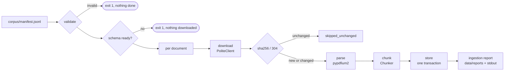

# 001 — Technical plan

## Design

Two CLI commands and a migration command, all in the `offshore_rag` package:

```
offshore-rag db migrate         SQL migrations → Postgres
offshore-rag build-manifest     BSEE listing pages → detail pages → corpus/manifest.jsonl
offshore-rag ingest             manifest → download → parse → chunk → store → report
```



### Ingestion run
1. Load and validate the whole manifest first (AC-001-02). Any problem → exit 1 before any network or database access.
2. Open the database and check that every migration has been applied (AC-001-12). `ingest` never migrates by itself: a missing schema is an operator error, reported with the connection target and the password masked.
3. Load `robots.txt` once per host and honour it; a disallowed URL fails with reason `robots_disallowed`.
4. Process documents **sequentially** (the rate limit makes concurrency pointless). Each document goes through download → parse → chunk → store, and any exception inside those stages becomes a `DocumentFailure(stage, reason)` for that document only (AC-001-10). Exceptions outside a document (database lost mid-run, disk full) are fatal.
5. Parse and chunk happen **before** the database transaction. The store stage writes the document, its pages and its chunks in one transaction, so a failure at any stage leaves the previous version untouched (AC-001-09).
6. At the end, write the report and print the summary (AC-001-11). Exit code: 0 all good, 3 at least one document failed, 1 fatal.

### Change detection
- The stored document keeps `sha256`, `etag` and `last_modified`. The client sends `If-None-Match` / `If-Modified-Since`; a `304` means `skipped_unchanged` without downloading.
- On a `200`, the bytes are hashed. Same hash as stored → `skipped_unchanged` (AC-001-08). Different → parse, chunk and replace (AC-001-09).
- A declared `sha256` in the manifest that does not match the downloaded bytes fails the document with `hash_mismatch` before anything is stored (AC-001-03).
- A 404 for a document already stored keeps the stored version and reports the download as failed.

### Raw files
Raw PDFs are stored content-addressed under `data/raw/<sha256>.pdf` (written to a temp file and renamed). The document row records the path. Old raw files of replaced documents are not deleted in R1 (cheap, and useful for debugging); a cleanup command can come later.

### Manifest building
`build-manifest` uses the same `PoliteClient`. It walks:
- **Safety Alerts**: listing `?page=0,1,…` until a page has no rows; each row links to a detail page; the detail page holds the PDF link.
- **Panel reports**: listing `?page=0,1,…` the same way; each row links to a detail page with the PDF.
- **District reports**: one listing page; the date cell links straight to the PDF.

Every fetched HTML page is saved under `data/listings/` for debugging. Relative links are resolved against the page URL (some district links have no leading slash). Entries are deduplicated by source URL and written sorted by `source_url` with sorted keys, so two builds from the same input are byte-identical (AC-001-01). A listing that yields **zero** entries is an error: it means BSEE changed its HTML and the parser is out of date. A single **detail page without a PDF link** is not: BSEE publishes some detail pages with no file (Safety Alert 395 was found this way). That page is skipped and logged as a warning that names its URL, `build-manifest` prints how many detail pages were skipped and which, and the rest of the manifest is written. If every detail page of a listing lacks a PDF, the listing yields zero entries and the run fails as above. The base URL is configurable so tests run against a local server.

### Parsing
pypdfium2 ([ADR-0002](../../adr/0002-pdf-text-extraction.md)) extracts the text page by page, so page `k` in the store is page `k` of the PDF (AC-001-05). Text is normalized: Unicode NFC, `\r\n` → `\n`, ligatures expanded, trailing spaces trimmed. A page is **image-only** when its extracted text has fewer than 20 non-whitespace characters (AC-001-06). Encrypted or unreadable PDFs fail at stage `parse`.

### Chunking
`Chunker` is an interface: an `id` (for example `fixed_words`), a `params` dict and `chunk(pages) -> list[ChunkDraft]`. R1 ships one baseline, **`FixedWordChunker(size=250, overlap=40)`**:
- It concatenates the text of the non-image-only pages, keeping a map from character offset to page number.
- It cuts windows of `size` words with `overlap` words of overlap, so a chunk can span consecutive pages and records `page_start`/`page_end` from the offset map (AC-001-07).
- It never crosses documents, never emits empty chunks, and every page with text falls in at least one window.

The active chunkers come from configuration (`CHUNKERS=fixed_words`). Each chunk row stores `chunker` and `chunker_params`, so R2 can add strategies and compare them without mixing chunk sets.

### Configuration
Configuration uses `pydantic-settings`, read from the environment or `.env`:
- `DATABASE_URL`
- `DATA_DIR` (default `data`)
- `MANIFEST_PATH` (default `corpus/manifest.jsonl`)
- `BSEE_BASE_URL` (default `https://www.bsee.gov`)
- `HTTP_USER_AGENT` (default `offshore-incident-rag/<version> (+https://github.com/meilantiago/offshore-incident-rag)`)
- `HTTP_RATE_PER_SECOND` (default 1.0)
- `HTTP_MAX_RETRIES` (default 4)
- `HTTP_TIMEOUT_SECONDS` (default 30)
- `CHUNKERS`

### Logging
Structured logs with `structlog`: one event per document and stage, with `document_url`, `stage`, `duration_ms` and `outcome`. JSON output when `LOG_FORMAT=json`; readable console output otherwise.

### New dependencies
Runtime:
- `httpx`
- `beautifulsoup4` + `lxml`
- `pypdfium2`
- `psycopg[binary]` 3
- `pydantic-settings`
- `structlog`
- `typer`

Dev:
- `fpdf2`, which generates the synthetic test PDFs.
- `pytest-timeout`

## Data model

### Migrations
Plain SQL files in `src/offshore_rag/db/migrations/NNNN_name.sql`, applied in order by `offshore-rag db migrate`. Applied versions are recorded in `schema_migrations(version text primary key, applied_at timestamptz)`, and each file runs in its own transaction. There is no ORM: queries are hand-written SQL through psycopg, typed at the boundary. `0001_corpus.sql` creates the three tables below and enables nothing else (pgvector is R2).

### Tables

`documents`
| Column | Type | Notes |
|---|---|---|
| id | bigint identity PK | |
| source_url | text not null unique | one row per PDF (AC-001-08) |
| doc_type | text not null | check in (`safety_alert`, `panel_report`, `district_report`) |
| listing_url | text not null | page where the link was found |
| sha256 | char(64) not null | of the stored raw bytes |
| retrieved_at | timestamptz not null | UTC |
| etag, last_modified | text null | for conditional requests |
| raw_path | text not null | `data/raw/<sha256>.pdf`, relative to `DATA_DIR` |
| page_count | int not null | check > 0 |
| image_only | boolean not null | true when every page is image-only |
| created_at, updated_at | timestamptz not null | |

`pages`
| Column | Type | Notes |
|---|---|---|
| document_id | bigint FK → documents on delete cascade | |
| page_number | int not null | check ≥ 1; PK (document_id, page_number) |
| text | text not null | may be empty when image-only |
| image_only | boolean not null | |
| char_count | int not null | |

`chunks`
| Column | Type | Notes |
|---|---|---|
| id | bigint identity PK | cited by R3 |
| document_id | bigint FK → documents on delete cascade | |
| chunker | text not null | strategy id |
| chunker_params | jsonb not null | |
| ordinal | int not null | unique (document_id, chunker, chunker_params, ordinal) |
| page_start, page_end | int not null | check 1 ≤ page_start ≤ page_end |
| text | text not null | check length(text) > 0 |
| char_count, word_count | int not null | chunk size distribution metric |

The `page_end ≤ page_count` rule spans tables, so it is enforced in code and verified by AC-001-07's test rather than by a trigger.

### Replacement
Replacement runs in one transaction:
1. `SELECT … FOR UPDATE` on the document row.
2. `DELETE` its pages and chunks.
3. `UPDATE` the document row.
4. Insert the new pages and chunks with `COPY`.

A new document is an `INSERT` followed by the same inserts.

## Contracts

### Package layout
```
src/offshore_rag/
  config.py                 Settings (pydantic-settings)
  cli.py                    typer app: db migrate | build-manifest | ingest
  logging.py                structlog setup
  db/connection.py          connect(settings) -> psycopg.Connection; DatabaseUnavailable
  db/migrate.py             migrate(conn); pending_migrations(conn) -> list[str]
  db/migrations/0001_corpus.sql
  ingestion/manifest.py     ManifestEntry, load_manifest, write_manifest, ManifestError
  ingestion/listings.py     parse_safety_alert_listing / _detail, parse_panel_listing / _detail, parse_district_listing
  ingestion/build.py        build_manifest(client, base_url, listings_dir) -> list[ManifestEntry]
  ingestion/http.py         PoliteClient, FetchResult, FetchError
  ingestion/pdf.py          parse_pdf(data: bytes) -> ParsedPdf; PdfParseError
  ingestion/chunking.py     Chunker (Protocol), ChunkDraft, FixedWordChunker, chunkers_from_config
  ingestion/store.py        CorpusStore
  ingestion/pipeline.py     run_ingest(...) -> IngestionReport
  ingestion/report.py       IngestionReport, DocumentOutcome, write_report, format_summary
```

### Manifest format
`corpus/manifest.jsonl` has one JSON object per line, sorted by `source_url`, with keys sorted:
```json
{"doc_type": "safety_alert", "listing_url": "https://www.bsee.gov/safety-alerts/…", "sha256": null, "source_url": "https://www.bsee.gov/sites/bsee.gov/files/….pdf", "title": "…"}
```
- `load_manifest(path) -> list[ManifestEntry]` raises `ManifestError(problems: list[str])`. Each problem names the line number and the source URL when there is one. An empty file is a problem.
- `write_manifest(entries, path)` is deterministic: UTF-8, `\n` line endings, `ensure_ascii=False`.

### HTTP
`PoliteClient(user_agent, rate_per_second, max_retries, timeout, clock, sleep)`:
- `get(url, etag=None, last_modified=None) -> FetchResult(status, content, etag, last_modified, attempts)`.
- A token bucket keeps the interval between any two requests at or above `1/rate`.
- 429, 5xx, timeouts and connection errors are retried with exponential backoff and jitter, honouring `Retry-After`. 404 and other 4xx fail at once with `FetchError(reason="http_404", …)`.
- `clock` and `sleep` are injectable so tests can measure the spacing without waiting.
- `allowed(url) -> bool` checks robots.txt.

### PDF
`parse_pdf(data) -> ParsedPdf(pages: list[PageText(number, text, image_only)])` raises `PdfParseError` for corrupt or encrypted files.

### Chunker interface
```python
class Chunker(Protocol):
    id: str
    params: Mapping[str, int | str]
    def chunk(self, pages: Sequence[PageText]) -> list[ChunkDraft]: ...

ChunkDraft(ordinal, page_start, page_end, text)
```

### Store
`CorpusStore(conn)`:
- `get_document(source_url) -> StoredDocument | None`
- `save_document(entry, fetch, sha256, raw_path, parsed, chunks_by_chunker) -> Literal["ingested", "replaced"]`, in one transaction.
- `counts() -> CorpusCounts`

### Run and outcomes
`run_ingest(entries, client, store, chunkers, data_dir, clock) -> IngestionReport`.

`DocumentOutcome(source_url, status, stage, reason, pages, chunks, durations_ms)` has these values:
- `status` ∈ {`ingested`, `replaced`, `skipped_unchanged`, `failed`}
- `stage` ∈ {`download`, `parse`, `chunk`, `store`}, for failures only

### CLI and exit codes
| Code | Meaning |
|---|---|
| 0 | every entry ingested, replaced or skipped |
| 3 | finished, with at least one document failed (AC-001-10) |
| 1 | fatal: invalid manifest, database unavailable or not migrated, unexpected error (AC-001-02, AC-001-12) |

The report goes to `data/reports/ingest-<UTC yyyymmddThhmmssZ>.json`. It holds the counts and failures of AC-001-11, plus bytes downloaded, request and retry counts, image-only page share and the chunk size distribution (min, median, max words).

### Test infrastructure
Test infrastructure lives in `tests/`, never in `src/`:
- `tests/support/http_server.py`: a threaded local HTTP server that serves fixture files. Per-path scripted responses (fail N times with 429/503/timeout, 404, ETag/304) and a log of request headers and timestamps.
- `tests/support/pdfs.py`: generates synthetic PDFs with fpdf2. One has text pages with a unique marker each (`PAGE-MARKER-0001`…); one is image-only; one is corrupt bytes.
- `tests/fixtures/bsee/`: trimmed recorded HTML of the three listing pages and two detail pages, plus one small real Safety Alert PDF with no third-party images, and `SOURCES.md` with the source URL and retrieval date of each.
- A `postgres` fixture connects to `TEST_DATABASE_URL`, creates a fresh schema per test with `search_path`, and runs the migrations.

## Test strategy

Integration tests are marked `integration`. They need Postgres: `docker compose up -d db` locally, a service container in CI. All of them run in CI; none contacts bsee.gov.

| AC | Layer | Test |
|---|---|---|
| AC-001-01 | integration (local HTTP, no DB) | `tests/ingestion/test_manifest_build.py`: recorded listing and detail pages served locally → manifest has the expected entries, types and listing URLs, no duplicate URLs, two builds byte-identical; a listing with zero rows fails |
| AC-001-02 | integration (DB) | `tests/ingestion/test_manifest_validation.py`: each malformed manifest variant → exit 1, the offending entry named, no requests received by the local server, document count 0 |
| AC-001-03 | integration (DB + local HTTP) | `tests/ingestion/test_ingest_provenance.py`: stored URL, type, UTC `retrieved_at`, sha256 equals hash of the file under `data/raw/`; declared wrong sha256 → `hash_mismatch`, no rows |
| AC-001-04 | integration (local HTTP) | `tests/ingestion/test_polite_client.py`: User-Agent header on every request, contains the repo URL and no `@`; spacing between recorded request timestamps ≥ 1/rate; 429/503/timeout retried up to the limit; 404 attempted once |
| AC-001-05 | unit + integration | `tests/ingestion/test_pdf_pages.py`: synthetic N-page PDF → N pages numbered 1..N, page k holds marker k only; same check on the stored pages |
| AC-001-06 | integration (DB) | `tests/ingestion/test_image_only.py`: image-only PDF stored with pages flagged, zero chunks, listed under image-only in the report, not counted as failed |
| AC-001-07 | unit + integration | `tests/ingestion/test_chunking.py`: chunk invariants (one document, chunker and params recorded, 1 ≤ page_start ≤ page_end ≤ page_count, non-empty text found in its page range, every text page covered); a second chunker writes a separate chunk set without touching the first |
| AC-001-08 | integration (DB + local HTTP) | `tests/ingestion/test_reingest.py::test_unchanged`: second run → all `skipped_unchanged`, row counts identical, one row per URL; both the 304 path and the same-hash 200 path |
| AC-001-09 | integration (DB + local HTTP) | `tests/ingestion/test_reingest.py::test_changed`: changed bytes → `replaced`, new sha256, old pages and chunks gone; a corrupt new version → old version intact and reported failed |
| AC-001-10 | integration (DB + local HTTP) | `tests/ingestion/test_partial_failure.py`: corrupt PDF + 404 + valid entries → valid ones stored, failures with URL, stage and reason, exit code 3 |
| AC-001-11 | integration (DB + local HTTP) | `tests/ingestion/test_report.py`: report JSON exists under `data/reports/` with every count and per-stage durations; stdout summary has the same numbers |
| AC-001-12 | integration | `tests/ingestion/test_fatal_db.py`: unreachable port → exit 1, no request to the local server, message names host/port/db and does not contain the password; reachable DB without migrations → same |

## Evaluation impact
None on quality metrics: no retrieval or answers exist yet. The ingestion report records the chunk size distribution and the share of image-only pages, which are inputs to R2's design and to the OCR decision. No golden set or evaluation run is needed before merging.

## Risks
- **BSEE changes its HTML.** The listing parsers then return zero or wrong rows. Mitigations:
  - The parsers are tested against recorded pages.
  - A listing with zero entries is an error.
  - `build-manifest` prints per-type counts, so a sudden drop is visible.
- **Bot protection (403) on bsee.gov.** A 403 is not retried. It is reported per document, and if every request of a run gets 403 the summary says so explicitly. The run does not try to evade it: no rotating user agents, no headless browser.
- **First full run is slow.** About 1,300 PDFs plus about 600 detail pages at about 1 request per second takes roughly 35–40 minutes. That is acceptable (spec), and re-runs are cheap thanks to 304s and hash checks.
- **Text extraction quirks.** Possible problems:
  - Repeated headers and footers on every page.
  - Hyphenation at line ends.
  - Multi-column layouts read out of order.
  - Tables flattened.

  These do not break the ACs, but they affect retrieval quality. They are measured in R2 rather than guessed at now.
- **Scanned share unknown.** If most district reports turn out to be image-only, R2 starts with a thin corpus. The report makes this visible on the first run, and OCR then becomes a roadmap item (spec decision).
- **Disk use.** Raw PDFs are probably a few GB. They live in the ignored `data/` directory, and the README states the expected size after the first run.
- **Windows paths and encodings.** Every file is written UTF-8 with `\n`, and raw files are named by hash, not by title.

## ADRs
- [ADR-0002: PDF text extraction with pypdfium2](../../adr/0002-pdf-text-extraction.md), status **proposed**.
- ADR-0001 (stack) moves from proposed to accepted when this plan is approved, because R1 is the first spec that uses it.
- No ADR for the smaller choices: `typer` for the CLI, plain SQL migrations instead of Alembic (no ORM, three tables), and `httpx` with a hand-written retry instead of `tenacity` (the retry rules are AC-001-04 itself and need to be visible and testable). They are recorded here and can be revisited without cost.
