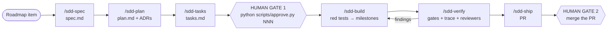

# How work is done here: spec-driven development with a harness

Every product change goes through the same cycle: **spec → plan → tasks → human approval → red tests → implementation → verification → PR → human merge**.

Agents do most of the work. Two decisions are made by a person, and "finished" is decided by deterministic gates, not by an agent's opinion ([constitution](constitution.md) §2).

## The cycle



| Step | Command | Who works | Output | What checks it |
|---|---|---|---|---|
| 1 | `/sdd-spec <idea>` | `spec-writer` | `docs/specs/NNN-slug/spec.md` | `spec-lint` |
| 2 | `/sdd-plan NNN` | main session | `plan.md` and ADRs if needed | `spec-lint` (the plan covers every AC) |
| 3 | `/sdd-tasks NNN` | main session | `tasks.md`, grouped in milestones | `spec-lint` (tasks cover every AC; cited sections exist) |
| 4 | — | **a person** | `status: approved` + hash | `approve.py` (interactive) |
| 5 | `/sdd-build NNN` | `test-writer`, then `implementer`, one milestone at a time | red tests, then code, one commit per milestone | fast gates after each milestone |
| 6 | `/sdd-verify NNN` | `reviewer`, plus `eval-auditor` when retrieval, prompts or `eval/` change | findings → fix tasks | `check --all` + `trace` |
| 7 | `/sdd-ship NNN` | main session | PR with the AC → test matrix | CI |
| 8 | — | **a person** | merge to `main` | branch protection |

`/sdd-status` shows where every spec stands.

## The two human approvals

**Gate 1: spec and plan.** Read `spec.md` and `plan.md` (and `tasks.md` if you want). If you agree, in a terminal:

```
python scripts/approve.py 007
```

The script asks you to type the id to confirm, runs `spec-lint` in strict mode (no open questions, plan and tasks covering every AC) and writes `status: approved`, `approved_hash`, `approved_at` and `approved_by` into the spec frontmatter.

- The hash covers `spec.md` and `plan.md`.
- `tasks.md` is left out on purpose: tasks are adjusted during implementation without changing the contract.
- Agents cannot approve: `guard_bash` blocks the script, `guard_edit` blocks writing those fields, and the script requires an interactive terminal.

**Gate 2: merge.** You review the PR (the AC → test matrix and the gate results are generated) and merge it. No agent pushes to `main`.

## When a spec changes after approval

If `spec.md` or `plan.md` is edited, the hash no longer matches and the `approval` gate fails with "changed after approval". The spec shows as `stale` in `STATUS.md`. You review the change and run `approve.py` again. No scope change gets in without you seeing it.

## Spec states

The frontmatter only stores `draft`, `approved` or `superseded`. The rest is derived by `scripts/status.py`:

| State | Meaning |
|---|---|
| `draft` | Being written. Product code cannot be touched in its name. |
| `approved` | Approved; no tasks closed yet. |
| `stale` | Approved, but spec or plan changed afterwards. Needs re-approval. |
| `in-progress` | Approved, with some tasks closed. |
| `done` | Approved, every task closed and every AC with a test. On `main` this only happens through a merged PR. |
| `superseded` | Replaced by another spec. |

## Branches and commits

- **One spec, one branch, one PR:** `spec/NNN-slug`. Everything for that spec (docs, tests and code) goes there.
- Changes to the harness itself go on `harness/<topic>` branches.
- Product code (`src/`, `tests/`, `eval/`, `docker/`; see `PRODUCT_PATHS` in `scripts/harness_config.py`) can only be touched from a `spec/NNN-*` branch whose spec is approved. The `approval` gate checks it.
- Commits use [Conventional Commits](https://www.conventionalcommits.org/) with the spec number as scope:
  - `docs(007): draft spec`
  - `test(007): red acceptance tests for AC-007-01..05`
  - `feat(007): H2 hybrid retrieval (T04–T07)`
  - `fix(007): T91 citation offsets`

## Gates

`python scripts/check.py` runs the gates registered in [`scripts/harness_config.py`](../scripts/harness_config.py).

- `--fast` runs the fast ones. The `gate_on_stop` hook runs them when an agent finishes with uncommitted changes. If the tree and the branch are the same as in the last green run, they are not repeated; `--no-cache` forces them.
- `--all` runs every gate. CI and `/sdd-verify` run it.

| Gate | Fast | What it checks |
|---|---|---|
| `spec-lint` | yes | Structure of specs, plans and tasks; AC ids; completeness of approved specs |
| `approval` | yes | Hash of approved specs; product code only from an approved spec branch |
| `status-fresh` | yes | `STATUS.md` is regenerated |
| `secrets` | yes | No keys or tokens in the repository |
| `format` | yes | `ruff format --check` |
| `lint` | yes | `ruff check` |
| `typecheck` | yes | `mypy --strict` on `src/` |
| `trace` | no | Every AC of an approved spec has a test; no test cites a non-existent AC |
| `harness-tests` | no | Tests of the harness scripts and hooks |
| `tests` | no | `pytest tests/` (unit and integration; `llm`-marked tests are skipped in CI) |

Specs add gates when they add infrastructure: the evaluation spec adds `eval-regression`, which fails when a metric drops significantly against the stored baseline.

Acceptance tests are never fast gates: during the build they are red on purpose. `mypy` only checks `src/`, so red tests that import modules that do not exist yet do not block a milestone that does not touch them.

## Milestones, context and models

- **Milestones.** `tasks.md` groups tasks into milestones (`## H1 — Title`). Each milestone is one agent invocation and one commit. It carries `Agent`, `Model` and `Context`.
- **Just-enough context.** `Context` cites the plan sections the milestone needs (`plan.md#Data model`). `python scripts/context.py NNN H1` prints those sections, the tasks and the ACs they cover; the agent works from that and does not read the whole plan. `spec-lint` checks that the cited sections exist.
- **Models.** `opus` for product judgement, acceptance tests, retrieval, grounding and evaluation (`spec-writer`, `test-writer`, `eval-auditor`); `sonnet` for implementation and code review (`implementer`, `reviewer`). A milestone's `Model` overrides the agent's.

## Verification findings

`/sdd-verify` approves nothing. Reviewers return concrete findings (file, line, failure scenario); the confirmed ones are added to `tasks.md` under `## Verification fixes` as normal tasks (`T90`, `T91`, …). Back to `/sdd-build` until there are no confirmed findings and `check --all` is green.

## Shape of a spec

Templates live in [`docs/specs/_templates/`](specs/_templates/).

- **`spec.md`:** what and why. Frontmatter + problem, users, stories, **acceptance criteria** (`**AC-NNN-XX** — Given …, when …, then …`), non-goals, data and provenance, metrics, open questions (`- [ ]` open, `- [x]` resolved).
- **`plan.md`:** how. Design, data model, contracts, test strategy (which layer tests each AC), evaluation impact, risks, ADRs.
- **`tasks.md`:** in which order. `**TNN**` tasks with `AC`, `Files`, `Test first` and `Done when`.
